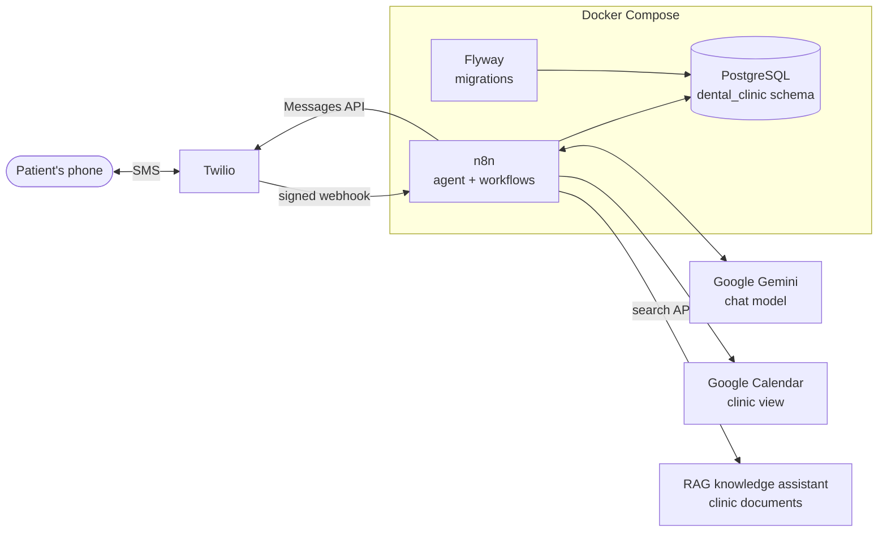

# SMS AI Receptionist

An AI receptionist that answers patients by **text message (SMS)** for a (fictional) dental clinic: it answers
questions, books, checks, reschedules and cancels appointments, and answers from the clinic's own documents.

Built with **n8n**, **Google Gemini**, **PostgreSQL** and **Twilio**, packaged with Docker Compose.

> **Demo clinic.** Maple Grove Dental Studio (New York) is fictional; its services, prices and address are made up.
> It is a portfolio project, not a production deployment.
>
> **Status:** tested end to end with signed fake SMS (`scripts/simulate-sms.py`): signature check, buffer, booking,
> clinic documents and duplicate handling, up to the Twilio send call. A test with a real Twilio number is pending.
>
> Based on [whatsapp-ai-receptionist](https://github.com/villasana26enrique/whatsapp-ai-receptionist): same agent,
> tools and database, with the WhatsApp and voice parts replaced by a Twilio SMS channel.

## What it does

- **Natural conversation in the patient's language** (English, Spanish, …) with memory per phone number.
- **Short, plain-text replies**: 1 to 3 sentences, no lists or emojis, because every 160 characters is billed as
  another SMS (and an emoji switches the whole message to the 70-character encoding).
- **Answers from the clinic's documents**: aftercare, insurance, payments, cancellation fees and emergencies come
  from the [RAG knowledge assistant](https://github.com/villasana26enrique/rag-knowledge-assistant), grounded in the
  clinic's own documents; if they do not answer the question, the agent says so instead of guessing.
- **Real availability**: free slots come from the database and depend on each service's duration
  (a 90-minute root canal needs three free 30-minute blocks).
- **Booking with confirmation**: the agent summarizes service, date and time and only books after a clear "yes".
  Each appointment gets a booking code (e.g. `MG-7K3QX`).
- **Check, reschedule and cancel**: patients can only touch their own appointments
  (same phone number, or booking code + full name from another number).
- **Messages sent in a row are answered once**: an 8-second buffer merges "hi" / "I need a cleaning" / "on Monday".
- **Only Twilio can talk to it**: every webhook is checked against Twilio's request signature.
- **Google Calendar mirror**: the clinic sees every appointment in its calendar; if Google fails, a sync job repairs it.
- **Retention policies**: chat history is deleted after 90 days.

## Architecture



**Message flow** (workflow `SMS AI Receptionist`):

1. Twilio posts the SMS to `/webhook/twilio/sms`. A Code node recomputes the `X-Twilio-Signature`; if it does not
   match, n8n answers `403` and stops.
2. n8n answers `200` with an empty TwiML document right away, so Twilio does not time out (15 s) while the agent works.
3. Opt-out and help keywords (`STOP`, `HELP`, …) are left to Twilio, which answers them itself.
4. The message is buffered for 8 seconds; only the execution of the latest message continues, with all texts merged.
5. The **AI Agent** (Gemini + Postgres chat memory) replies, calling these tools when needed:

   | Tool | Sub-workflow | Database function |
   |---|---|---|
   | `check_availability` | Tool: Check availability | `get_available_slots` |
   | `book_appointment` | Tool: Book appointment | `book_appointment` |
   | `get_my_appointments` | Tool: Get my appointments | `get_my_appointments` |
   | `cancel_appointment` | Tool: Cancel appointment | `cancel_appointment` |
   | `reschedule_appointment` | Tool: Reschedule appointment | `reschedule_appointment` |
   | `search_clinic_documents` | Tool: Search clinic documents | — (calls the RAG search API) |

6. The reply is sent through the Twilio Messages API, from the number the patient wrote to.

Background workflows: **Sync appointments to Google Calendar** (every 15 min) and **Daily maintenance** (3 AM).

## Design decisions

- **Verify the sender.** A webhook URL is public; without a check anyone could post fake messages and make the agent
  book appointments. Twilio signs each request with the account's Auth Token (HMAC-SHA1 over the URL and the sorted
  parameters), and the workflow rejects anything that does not match, comparing in constant time.
- **Answer the webhook first, reply later.** Twilio waits at most 15 seconds for the webhook, and the buffer plus the
  agent take longer. So the webhook gets an empty TwiML right away, and the reply goes out through the API.
- **The database is the source of truth; the calendar is a mirror.** Booking is one atomic database operation.
  Google Calendar is updated afterwards, and a `calendar_synced` flag lets the sync job create, move or delete
  events that failed (eventual consistency). A Google outage never loses an appointment.
- **Double booking is impossible at the database level**: an `EXCLUDE USING gist` constraint rejects overlapping
  confirmed appointments, even if two requests arrive in the same millisecond.
- **Code does the math, the LLM does the talking.** Free slots, opening hours and durations are computed in SQL;
  the model only converses and calls tools. All business rules live in PL/pgSQL functions that return
  `{ok, message}` instead of raising errors, so the agent can explain what went wrong.
- **Ownership checks** never reveal whether another person's booking code exists.
- **Soft delete**: cancelled appointments keep their row and full history (`appointment_history`).
- **Idempotency**: the message buffer has a unique `MessageSid`, so a message delivered twice is answered once.
- **Never silent**: the agent retries, then switches to a fallback model (Gemini's free tier often answers 503 "high
  demand"); if both fail, the patient gets an apology in their language instead of no reply.
- **LLM-agnostic**: the model is one node; swapping Gemini for Claude or GPT does not touch tools or data.
- **Structured data from the database, long text from documents.** Prices, hours and availability are SQL;
  aftercare and policies come from the RAG service over HTTP. The RAG key belongs to its `patient-assistant` agent
  (it cannot read the staff handbook), and only the question is sent — never the patient's phone number.
- **The channel is only the edges.** The phone number is stored as digits only, and replies go back to the address
  the message came from, so the same workflow is meant to work with Twilio's WhatsApp sender (`whatsapp:+1…`) too
  (not tested yet).

## Tech stack

| Piece | Technology |
|---|---|
| Orchestration and agent | n8n 2.40 (AI Agent node, sub-workflows as tools) |
| LLM | Google Gemini (`gemini-3.1-flash-lite`, with `gemini-flash-lite-latest` as fallback) |
| Database | PostgreSQL 16 + pgvector, PL/pgSQL functions |
| Migrations | Flyway (versioned `V__` + repeatable `R__`) |
| Messaging | Twilio Programmable Messaging (SMS) |
| Infrastructure | Docker Compose, optional ngrok tunnel |

## Repository layout

```
├── docker-compose.yml
├── .env.example
├── database/
│   ├── migrations/      V1 schema · V2 demo clinic data · V3 chat history · V4 message buffer
│   ├── functions/       R__ repeatable migrations: booking, appointment management, cleanup
│   └── tests/           booking_tests.sql
├── n8n/
│   ├── workflows/       the agent and its tools, exported as JSON
│   └── scripts/         helpers used by setup-n8n.sh and export-workflows.sh
├── scripts/
│   ├── setup-n8n.sh         credentials + workflows + publishing on a fresh n8n
│   ├── reload-workflows.sh  loads workflow changes into n8n and publishes them
│   ├── export-workflows.sh  n8n → repository, without personal data or secrets
│   └── simulate-sms.py      sends a signed fake SMS to test without a phone
└── postgres/Dockerfile  PostgreSQL + pgvector
```

## Getting started

### Prerequisites

- Docker with Docker Compose, and Python 3 for `simulate-sms.py`.
- A [Twilio](https://www.twilio.com/) account with a phone number (the free trial works: it can text verified numbers).
- A [Google AI Studio](https://aistudio.google.com/) API key (Gemini).
- A Google Cloud OAuth client with the Google Calendar API enabled, and a calendar for the clinic.
- A public HTTPS URL for the webhook (e.g. an ngrok static domain).

### 1. Configure

```bash
cp .env.example .env        # fill in every value (each one is explained in the file)
```

### 2. Start and set up

```bash
docker compose up -d        # PostgreSQL + Flyway migrations and n8n (http://localhost:5680)
./scripts/setup-n8n.sh      # credentials, workflows and publishing
```

`setup-n8n.sh` takes an empty n8n to a working agent:

1. Creates the credentials from `.env`, with the ids the workflows reference, so every node is already linked.
2. Runs `./scripts/reload-workflows.sh`: imports the nine workflows from `n8n/workflows/` (ids preserved; calendar id,
   RAG URL and the Twilio signature check filled from `.env`), publishes them all (tools first) and restarts n8n.

Importing a workflow unpublishes it, so workflow changes are always loaded with `reload-workflows.sh`, never by
importing one file by hand (a scheduled workflow left unpublished stops running without any error).

| Credential | Used for | From `.env` |
|---|---|---|
| Postgres account | tools, chat memory, message buffer | `POSTGRES_*` (host `postgres`) |
| Twilio account | sending the replies | `TWILIO_ACCOUNT_SID`, `TWILIO_AUTH_TOKEN` |
| Google Gemini (PaLM) Api account | chat model | `GEMINI_API_KEY` |
| Google Calendar account | calendar mirror | `GOOGLE_OAUTH_CLIENT_ID`, `GOOGLE_OAUTH_CLIENT_SECRET` |
| RAG search API key | clinic documents (optional) | `RAG_SEARCH_API_KEY` (and `RAG_SEARCH_URL`) |

### 3. Try it without a phone

```bash
python scripts/simulate-sms.py "Hi, do you take Cigna?"
python scripts/simulate-sms.py "Hi" --bad-signature      # expect 403
```

The script signs the request exactly like Twilio does. The agent's answer is in the n8n executions (and in
`dental_clinic.chat_history`); sending it fails until real Twilio credentials are in `.env`.

### 4. The manual steps

- Open n8n, create the owner account, open **Credentials → Google Calendar account** and click
  **Sign in with Google** (Google requires a person to grant access).
- In the Twilio Console, open the phone number → **Messaging configuration → A message comes in**:
  Webhook, `HTTP POST`, URL `https://<your-public-domain>/webhook/twilio/sms`.
  It must be exactly `N8N_WEBHOOK_URL` + `webhook/twilio/sms`: the signature is computed over that URL.
- On a trial account, verify the phone you will text from (**Phone Numbers → Verified Caller IDs**).

## Deploying to a server

The same two commands work on any Linux server with Docker. On top of that:

- **HTTPS**: put a reverse proxy (Caddy, Traefik or nginx) in front of n8n, or use the `tunnel` profile
  (`docker compose --profile tunnel up -d`) with an ngrok static domain. Set `N8N_WEBHOOK_URL` to the public URL.
- **Do not publish PostgreSQL**: it is bound to `127.0.0.1` on purpose; reach it through an SSH tunnel.
- **Keep `N8N_ENCRYPTION_KEY` safe**: n8n encrypts stored credentials with it. Losing it means re-creating them
  (`./scripts/setup-n8n.sh` can do that from `.env`).
- **Rotating the Twilio Auth Token**: update `.env` and run `./scripts/setup-n8n.sh` again (it rewrites the
  credential and the signature check). Until then, every incoming SMS is rejected with `403`.
- **US texting rules**: sending SMS to real customers from a US local number requires an **A2P 10DLC** registration
  (brand + campaign) in Twilio; toll-free numbers need a toll-free verification instead. Not needed for the trial.
- **Backups**: `pg_dump` of the database plus the `n8n_data` volume. The workflows themselves are in this repository.
- **Google OAuth app**: in testing mode Google expires the calendar grant every 7 days; publish the OAuth app
  (or use a Google Workspace internal app) for a real deployment.

## Database

Flyway runs on every `docker compose up`:

- `database/migrations/V<n>__*.sql` run once, in order. **Never edit an applied one**: add `V<n+1>__…`.
- `database/functions/R__*.sql` are re-applied whenever their content changes (`CREATE OR REPLACE`).
- Every function pins `SET search_path = dental_clinic`, because n8n connects with the default schema.

### Tests

```bash
docker compose exec -T postgres sh -c 'psql -U "$POSTGRES_USER" -d "$POSTGRES_DB" -v ON_ERROR_STOP=1' < database/tests/booking_tests.sql
```

They run inside a transaction that is rolled back and print `ALL TESTS PASSED`. Covered: closed days, booking code
format, overlap rejection, duration-aware availability, opening hours, unknown services, past dates, the 30-minute
grid, ownership, rescheduling, double cancellation and history.

## Working on the workflows

Edit in the n8n UI, then export so the repository stays the source of truth:

```bash
./scripts/export-workflows.sh
```

The export removes instance data (owner email, versions, timestamps) and puts the placeholders back: calendar id,
RAG URL, and the Auth Token and URL of the signature check, so the token never reaches the repository.

## Privacy

- Conversations are stored for the agent's memory and **deleted after 90 days** (`Daily maintenance`).
- The bot never diagnoses or recommends medication; emergencies are sent to the clinic's phone.
- Gemini's free tier may use prompts to improve Google's models: use it only with test data.
  A real clinic needs a paid plan (and, in the US, a HIPAA review before handling patient data).

## Known limitations and next steps

- A message that is only the word `CANCEL` is an opt-out keyword for Twilio: it unsubscribes the patient instead of
  reaching the agent. Patients cancelling an appointment usually write more ("cancel my appointment"), which works.
- The Twilio Auth Token is written into the signature-check node at import time, so n8n users can read it in the
  editor (they can already use the Twilio credential). A reverse proxy could check the signature instead.
- Single chair: overlapping appointments are not allowed at all (multiple dentists would add a `dentist_id`).
- MMS (photos) are ignored; only the text is read.
- Next: appointment reminders (a scheduled SMS the day before), conversation evaluations, and handoff to a human.
